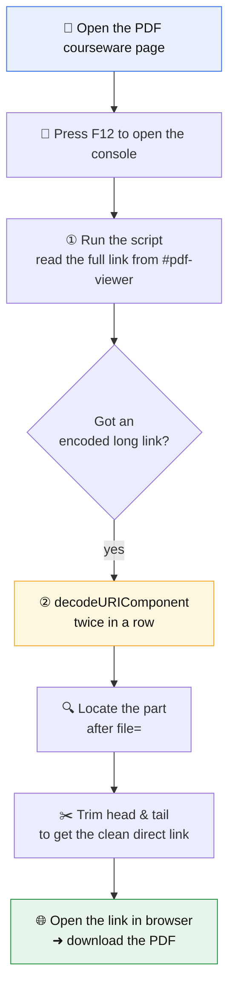

<div align="center">

English | [中文](README.md)

# 📄 AHMU PDF Courseware Direct-Link Downloader

**Anhui Medical University e-Learning Platform · Extract & download the real PDF direct link**


[](https://media.ahmu.edu.cn)
[](#)
[](#)
[](#)
[](LICENSE)

*No software needed — just your browser's built-in DevTools console (F12). Three steps to the real PDF download URL.*

</div>

---

## 📖 Contents

- [What is this](#-what-is-this)
- [When to use](#-when-to-use)
- [Prerequisites](#-prerequisites)
- [How it works](#-how-it-works)
- [Steps](#-steps)
- [Worked example](#-worked-example)
- [FAQ](#-faq)
- [Disclaimer](#-disclaimer)

---

## 🎯 What is this

When the platform previews a PDF courseware online, the page often shows **no "Download" button** — you can only page through it.
In reality, the PDF's true file URL is hidden inside the page's `#pdf-viewer` element, wrapped in **two layers of URL encoding**.

What this method does is simple:

> **Use the browser console as a "decoder": recover the PDF direct link in two steps, then open it in the browser to download.**

## ✅ When to use

| Scenario | Supported |
| :--- | :---: |
| The page **previews** the PDF fine but has no download button | ✅ |
| You want to save the courseware locally for offline review | ✅ |
| The page never loads the PDF (no preview permission) | ❌ |
| Bulk-scraping the whole site | ❌ (not recommended, see [Disclaimer](#-disclaimer)) |

## 🧩 Prerequisites

1. In a browser (Chrome / Edge / Firefox), **log in and open the target PDF courseware page**; confirm it previews normally.
2. Press <kbd>F12</kbd> (or <kbd>Ctrl</kbd> + <kbd>Shift</kbd> + <kbd>I</kbd> / on Mac <kbd>Cmd</kbd> + <kbd>Option</kbd> + <kbd>I</kbd>) to open **DevTools**, and switch to the **Console** panel.

---

## 🗺️ How it works



---

## 🛠️ Steps

> The snippets below can be pasted straight into the console, or taken from the [`snippets/`](snippets) directory.

### Step 1: Get the full pdf-viewer link

In the console of the **page where the PDF preview is open**, run:

```javascript
document.querySelector('#pdf-viewer').getAttribute('data-src') 
|| document.querySelector('iframe#pdf-viewer')?.src
|| [...document.querySelectorAll('a[href*="pdf-viewer"]')].map(a=>a.href)
```

It tries three fallbacks in order and returns an **encoded** long link (shaped like `https%3A%2F%2F...`). Copy that result.

> 💡 The three `||` branches are fallbacks: prefer `data-src`; if absent fall back to `iframe.src`; finally collect every `<a>` on the page pointing at `pdf-viewer`.

### Step 2: Decode twice to extract the download link

Paste the whole string from Step 1 between the quotes below, then run:

```javascript
decodeURIComponent(decodeURIComponent("把第一步的结果粘贴到这里"))
```

> 📝 The quoted text is a **placeholder** — replace it with your Step 1 result. (Kept verbatim to match the Chinese doc.)

The console prints the **decoded plaintext link**.

### Step 3: Trim head & tail to get the real direct link

In the decoded result, find the part after `file=` — that is the real download URL, shaped like:

```text
https://media.ahmu.edu.cn:443/download/file/{FILE_ID}?timestamp=...&token=...&name=...pdf
```

> ✂️ **Trim head & tail**: keep only the segment from `https://` up to `.pdf`; drop extra characters before/after (quotes, the `file=` prefix, trailing junk).

Paste this direct link into the browser address bar and hit Enter — the PDF downloads. 🎉

---

## 🔬 Worked example

```text
① Run the Step 1 script, get (illustrative, truncated):
   https%3A%2F%2Fmedia.ahmu.edu.cn%2F...%3Ffile%3Dhttps%253A%252F%252Fmedia...

② Run the Step 2 script decodeURIComponent(...) twice, get plaintext:
   ...?file=https://media.ahmu.edu.cn:443/download/file/123456?timestamp=1710000000&token=abcdef...&name=Chapter1 Intro.pdf...

③ Trim head & tail, keep from file= up to .pdf:
   https://media.ahmu.edu.cn:443/download/file/123456?timestamp=1710000000&token=abcdef...&name=Chapter1 Intro.pdf

④ Paste into the address bar, Enter ➜ browser downloads "Chapter1 Intro.pdf"
```

> The `FILE_ID`, `timestamp`, `token` in the example are **one-off placeholders**; use whatever your console actually prints. `token` / `timestamp` are usually time-limited — if expired, redo the flow.

---

## ❓ FAQ

<details>
<summary><b>Q1: Step 1 returns <code>null</code> or <code>undefined</code>?</b></summary>

The page hasn't loaded the PDF preview yet, or the selector didn't match. Check that:
- the page **actually previews** the PDF (not blank / error);
- you run the script on **the page showing the preview**, not a listing page;
- if the PDF lives in an `iframe`, switch the console's execution context to that iframe first.
</details>

<details>
<summary><b>Q2: After decoding, the link won't open / 403 / says expired?</b></summary>

The <code>token</code> and <code>timestamp</code> in the direct link are <b>time-limited</b>. Go back and <b>re-run Step 1 and Step 2</b> for a fresh link, then open it promptly.
</details>

<details>
<summary><b>Q3: Why decode twice?</b></summary>

The platform applies <b>two layers of URL encoding</b> (<code>%253A</code> → <code>%3A</code> → <code>:</code>). One decode only strips the outer layer; you need two nested <code>decodeURIComponent</code> calls to recover a directly-usable plaintext URL.
</details>

<details>
<summary><b>Q4: What exactly does "trim head & tail" mean?</b></summary>

Keep only the complete segment starting with <code>https://</code> and ending with <code>.pdf</code>; remove the <code>file=</code> (or quotes, etc.) before it and any extra parameters / junk after it.
</details>

---

## ⚖️ Disclaimer

- This project is for **personal study and technical research** only — saving courseware you are entitled to access, for offline review.
- Please respect your institution's / the platform's **terms of service** and applicable **copyright** rules. Do **not** use it for bulk crawling, redistribution, or any commercial purpose.
- Any consequence of using this method is borne by the user; the author and this project assume **no liability**.
- If the platform objects, contact the author to have it removed.

---

<div align="center">

**If you find it useful, a ⭐ Star is appreciated!**

[MIT Licensed](LICENSE) · Made with ❤️ for AHMU students

</div>
