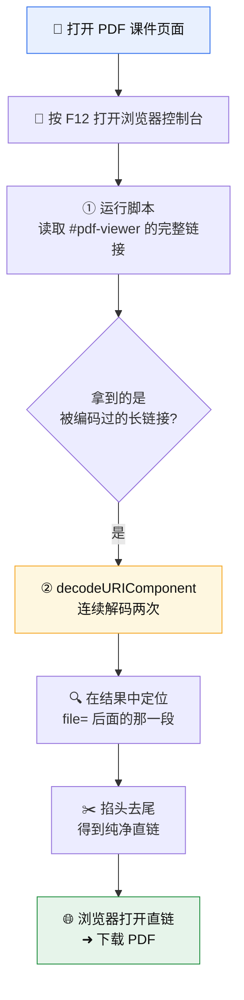

<div align="center">

# 📄 安医 PDF 课件直链下载法

[English](README.en.md) | 中文

**安徽医科大学网络教学平台 · PDF 课件「直链」提取与下载**


[](https://media.ahmu.edu.cn)
[](#)
[](#)
[](#)
[](LICENSE)

*无需任何软件，只需浏览器自带的开发者控制台（F12），三步拿到 PDF 真实下载地址。*

</div>

---

## 📖 目录

- [这是什么](#-这是什么)
- [适用场景](#-适用场景)
- [前置条件](#-前置条件)
- [原理速览](#-原理速览)
- [操作步骤](#-操作步骤)
- [实战示例](#-实战示例)
- [常见问题 FAQ](#-常见问题-faq)
- [免责声明](#-免责声明)

---

## 🎯 这是什么

平台在线预览 PDF 课件时，页面上往往**没有「下载」按钮**，只能一页页看。
但实际上，PDF 的真实文件地址就藏在页面的 `#pdf-viewer` 元素里，只是被**两层 URL 编码**包住了。

本方法做的事很简单：

> **把浏览器控制台当作「解码器」，两步还原出 PDF 的直链，再用浏览器直接打开即可下载。**

## ✅ 适用场景

| 场景 | 是否适用 |
| :--- | :---: |
| 页面能正常**在线预览** PDF，但没有下载按钮 | ✅ |
| 想把课件保存到本地离线复习 | ✅ |
| 页面根本没有加载出 PDF（无预览权限） | ❌ |
| 想批量抓取全站文件 | ❌（不建议，见[免责声明](#-免责声明)） |

## 🧩 前置条件

1. 用浏览器（Chrome / Edge / Firefox 均可）**登录平台并打开目标 PDF 课件页面**，确认能正常预览。
2. 按 <kbd>F12</kbd>（或 <kbd>Ctrl</kbd> + <kbd>Shift</kbd> + <kbd>I</kbd> / Mac 上 <kbd>Cmd</kbd> + <kbd>Option</kbd> + <kbd>I</kbd>）打开**开发者工具**，切到 **Console（控制台）** 面板。

---

## 🗺️ 原理速览



---

> 批量下载当前活动中允许下载的 PDF / PPTX 附件，请见[详细批量下载教程](docs/batch-download.md)。

## 🛠️ 操作步骤

> 下面的脚本可直接复制到控制台回车运行，也可从 [`snippets/`](snippets) 目录取用。

### 第一步：获取 pdf-viewer 完整链接

在**已打开 PDF 预览的页面**控制台里运行：

```javascript
document.querySelector('#pdf-viewer').getAttribute('data-src') 
|| document.querySelector('iframe#pdf-viewer')?.src
|| [...document.querySelectorAll('a[href*="pdf-viewer"]')].map(a=>a.href)
```

它会依次尝试三种取值方式，返回一串**被编码过**的长链接（形如 `https%3A%2F%2F...`）。复制这串结果。

> 💡 三段 `||` 是「兜底」逻辑：优先读 `data-src`，读不到再退而读 `iframe.src`，最后退而搜集页面里所有指向 `pdf-viewer` 的 `<a>` 链接。

### 第二步：对结果进行两次解码，提取下载链接

把上一步复制的整串内容，粘贴进下面引号中间再运行：

```javascript
decodeURIComponent(decodeURIComponent("把第一步的结果粘贴到这里"))
```

控制台会打印出**解码后的明文链接**。

### 第三步：掐头去尾，取出真正的直链

在解码结果里找到 `file=` 后面那一段，它就是真实下载地址，形如：

```text
https://media.ahmu.edu.cn:443/download/file/{文件ID}?timestamp=...&token=...&name=...pdf
```

> ✂️ **注意掐头去尾**：只保留从 `https://` 开始、到 `.pdf` 结束的这一段，去掉前后多余的字符（如引号、`file=` 前缀、结尾的杂项）。

把这段直链**粘贴到浏览器地址栏回车**，即可直接下载该 PDF。🎉

---

## 🔬 实战示例

```text
① 运行第一步脚本，得到（示意，已截断）：
   https%3A%2F%2Fmedia.ahmu.edu.cn%2F...%3Ffile%3Dhttps%253A%252F%252Fmedia...

② 运行第二步脚本 decodeURIComponent(...) 两次，得到明文：
   ...?file=https://media.ahmu.edu.cn:443/download/file/123456?timestamp=1710000000&token=abcdef...&name=第1章 绪论.pdf...

③ 掐头去尾，取出 file= 后到 .pdf 的这一段：
   https://media.ahmu.edu.cn:443/download/file/123456?timestamp=1710000000&token=abcdef...&name=第1章 绪论.pdf

④ 粘贴到地址栏回车 ➜ 浏览器开始下载「第1章 绪论.pdf」
```

> 示例中的 `文件ID`、`timestamp`、`token` 均为**一次性占位值**，实际以你控制台里跑出来的为准；`token` / `timestamp` 通常有时效，过期需重新走一遍流程。

---

## ❓ 常见问题 FAQ

<details>
<summary><b>Q1：第一步返回 <code>null</code> 或 <code>undefined</code>？</b></summary>

说明当前页面还没加载出 PDF 预览，或选择器没命中。请确认：
- 页面**确实能在线预览** PDF（不是空白 / 报错）；
- 在**预览所在的那个页面**运行脚本，而不是列表页；
- 若 PDF 在 `iframe` 内，可先在控制台顶部把执行上下文切换到对应 iframe 再运行。
</details>

<details>
<summary><b>Q2：第二步解码后链接打不开 / 403 / 提示过期？</b></summary>

直链里的 <code>token</code> 与 <code>timestamp</code> 有<b>时效性</b>。请回到页面<b>重新执行第一步、第二步</b>拿到新的直链，尽快打开下载。
</details>

<details>
<summary><b>Q3：为什么要解码两次？</b></summary>

平台对真实地址做了<b>两层 URL 编码</b>（<code>%253A</code> → <code>%3A</code> → <code>:</code>）。解一次只脱掉外层，必须 <code>decodeURIComponent</code> 套两层才能还原成可直接访问的明文。
</details>

<details>
<summary><b>Q4：「掐头去尾」到底掐什么？</b></summary>

只保留 <code>https://</code> 开头、<code>.pdf</code> 结尾的完整一段；去掉它前面的 <code>file=</code>（或引号等）以及后面可能跟着的其它参数 / 杂字符。
</details>

---

## ⚖️ 免责声明

- 本项目仅为**个人学习与技术研究**用途，用于保存自己有权访问的课件以便离线复习。
- 请遵守所在学校 / 平台的**服务条款**与相关**著作权、版权**规定，**勿**用于批量爬取、二次分发或任何商业用途。
- 因使用本方法产生的任何后果由使用者自行承担，作者与本项目**不承担责任**。
- 若平台方认为不妥，可联系作者删除。

---

<div align="center">

**觉得有用可以给个 ⭐ Star ～**

[MIT Licensed](LICENSE) · Made with ❤️ for AHMU students

</div>
